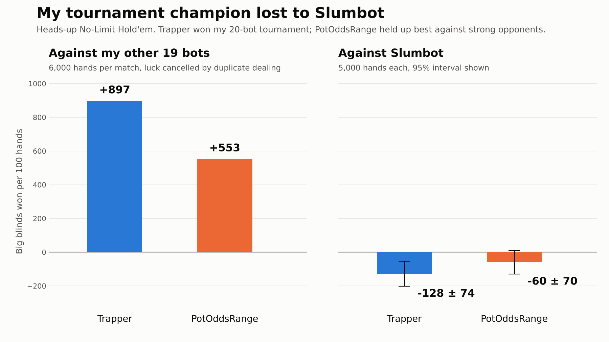

# Poker bots: does the tournament winner survive a real opponent?

I built 20 rule-based No-Limit Hold'em bots and ran them against each other. Then I tested the winners
the way you'd test a trading strategy: a fixed selection rule, a frozen holdout set of opponents, a
second game format, and a final test against Slumbot, a strong public poker bot.

The short answer: the tournament champion beat my field by exploiting weak bots, and it lost
clearly to Slumbot.

## Background

In Year 11 Specialist Maths I did an assignment on the combinatorics of poker hands: how many ways
there are to make each hand, how likely each one is, and which wins. This project turns that maths
into bots that make betting decisions with it.

It was also sparked by a bot competition I read about, where the winning entry went all-in every
single hand and the other bots kept folding. That's an exploitative strategy: it beats timid
opponents and loses to anyone who calls correctly. Here, the all-in bot finished 17th of 20.

## What I tested

| Stage | Setup | Result |
|---|---|---|
| Round-robin | 20 bots, every pair plays 6,000 hands with luck cancelled (each deck dealt twice, seats swapped) | Trapper wins: +897 bb/100 |
| Frozen holdout | 8 new opponents written before any results, run once | Trapper passes: +635 bb/100, beats 7 of 8 |
| 6-max | 1,200 random six-bot tables, two independent samples | PushFold wins both samples; Trapper drops to 9th |
| Slumbot | 5,000 hands each for Trapper and PotOddsRange | Trapper -128 +/- 74, PotOddsRange -60 +/- 70 bb/100 |

bb/100 = big blinds won per 100 hands. Intervals are 95%.

## What I learned

- **Winning a tournament of weak bots isn't skill.** Most of Trapper's lead came from four bad bots.
  Head to head against the good bots it was ordinary, and against Slumbot it lost big pots 60 to 22.
- **Every winner exploited the same flaw.** My bots judged calls against a random hand, when a big bet
  usually means a strong hand. Trapper and PushFold both profited from that. The only bot that
  adjusted for it, PotOddsRange, held up best against strong opponents in every test.
- **Check your variance-reduction method.** Slumbot's API returns a "baseline" meant to cancel luck. I
  made it my main metric mid-test, then found it was biased: it averaged -154 and -90 bb/100 when it
  should be about zero. I switched back to raw results. The full correction is in the journal.
- **Pre-register the test.** Every selection rule and pass condition was written down before the
  results, so the champion couldn't be tuned to fit them.

## Repo guide

- `equity.py`: chance of winning from any point in a hand, against a random hand or a top-X% range,
  heads-up or multiway.
- `engine.py`, `engine_multi.py`: heads-up and 6-max games, using PokerKit for the rules.
- `bots.py`: the 20 development bots. `holdout_bots.py`: the 8 frozen holdout opponents.
- `tournament.py`, `tournament_multi.py`, `analyse*.py`: tournament runs and result tables.
- `slumbot_client.py`: plays a bot against Slumbot's API. `test_slumbot_client.py` checks it
  against a mock Slumbot.
- `results/`: raw results for every test. `JOURNAL.md`: the full research log, mistakes included.

## Run it

    pip install pokerkit phevaluator
    python tests.py
    python equity_calc.py AsKs QsJh2d
    python tournament.py dev --decks 3000
    python analyse.py results/dev_roundrobin.json
    python slumbot_client.py --bot PotOddsRange --hands 5000
    python analyse_slumbot.py results/slumbot_*.jsonl

## Next

v2: a range-aware bot that estimates what the opponent holds from how they've bet, tested against
fresh holdout bots and then Slumbot over 15,000+ hands.

---
I designed the experiments and made the decisions; the code was written with Claude.
